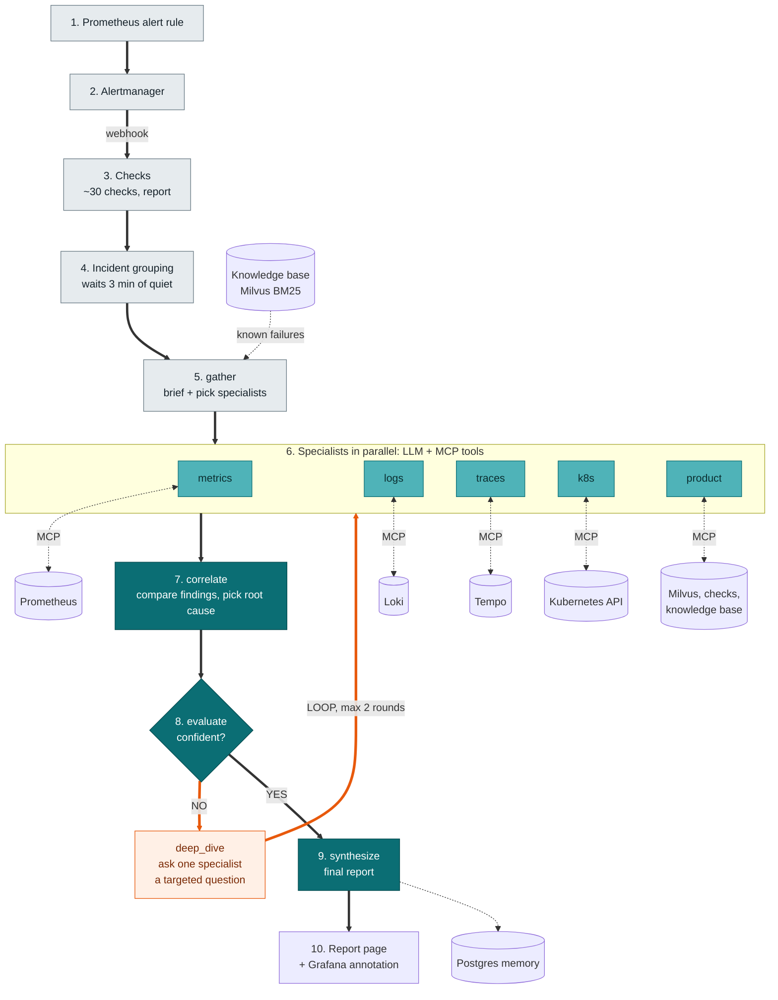
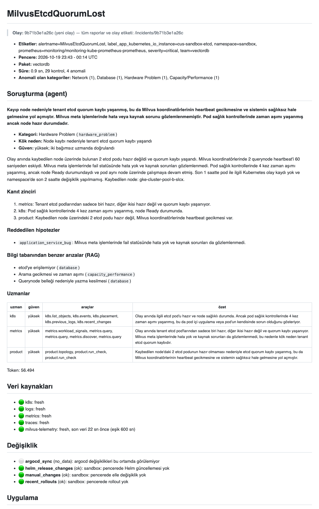
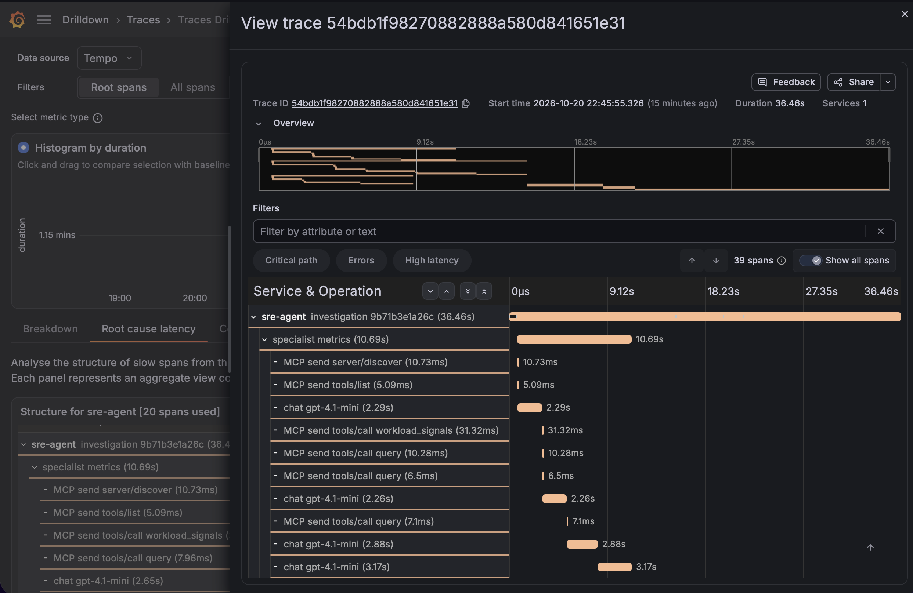
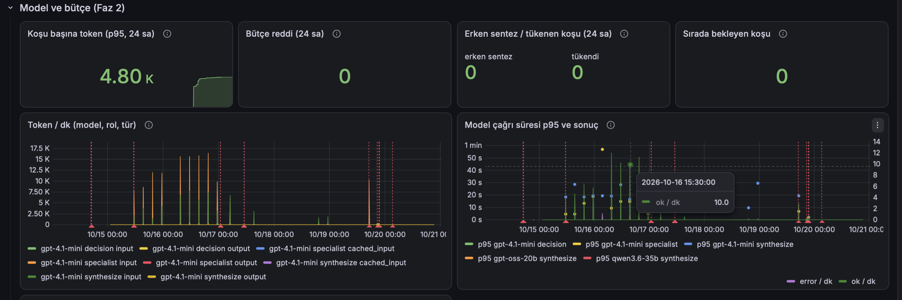

# SRE Agent

A read-only, multi-agent SRE assistant for a multi-tenant Milvus (vector database) platform on Kubernetes. When an alert fires, it collects evidence, lets specialist agents investigate with MCP tools, and writes a root-cause report that a human can verify.

## Problem

One infrastructure event (a lost node, an etcd quorum loss) restarts many components at once and floods the on-call engineer with alerts. Finding the first cause means jumping between Prometheus, Loki, Tempo and the Kubernetes API. Most of these failures have been seen before, but that knowledge lives in people's heads.

The agent answers the question an on-call engineer asks first: *what started this, and how sure are we?* It never changes the system. It only reads and reports.

## How it works



Grey steps are plain code. Light teal steps are agents (LLM + MCP tools). Dark teal steps are LLM-only reasoning. The orange edge is the loop.

1. **Checks** run without a model: ~30 deterministic checks (pods, nodes, capacity, network, etcd, Milvus coordinators…) produce a first report within seconds.
2. **Incident grouping** joins reports that belong to the same event and waits for 3 quiet minutes, so one node loss is investigated once, not ten times.
3. **gather** writes a brief, adds the closest known failures from the knowledge base (RAG), and picks specialists in code from the evidence.
4. **Specialists** run in parallel. Each is an LLM with its own read-only MCP server and calls tools in a loop (max 8 calls) until it can state a finding with evidence.
5. **correlate** compares the findings; **evaluate** decides whether the result holds. Code requires at least two specialists to support the same category (cross-validation).
6. If not, **deep_dive** sends one specialist a targeted question and the graph loops back (max 2 rounds).
7. **synthesize** writes the final report: root cause, evidence chain, rejected hypotheses, recommendations.

## Agentic parts

| Concept | In this project | Code |
| --- | --- | --- |
| LLM | Any OpenAI-compatible endpoint. Developed with an LLM gateway serving open-source models and Azure OpenAI gpt-4.1-mini. | `src/sre_agent/adapters/openai_compat.py`, `config/models.yaml` |
| Tool calling | 5 MCP servers, one per capability, read-only | `src/sre_agent/mcp/`, `src/sre_agent/graph/model_specialist.py` |
| Multi-agent | metrics, logs, traces, k8s and product specialists in parallel | `src/sre_agent/graph/routing.py`, `specialists.py` |
| Orchestration | LangGraph; routing is deterministic code, not a model decision | `src/sre_agent/graph/build.py`, `routing.py` |
| RAG | Failure catalog, specialist guides and taxonomy in Milvus, BM25 full-text search (no embedding model). Used in `gather` and as the `knowledge_search` tool. | `src/sre_agent/knowledge/`, `src/sre_agent/adapters/vector_store.py` |
| Memory | Postgres: reports, incidents, human labels, LangGraph checkpoints | `src/sre_agent/store/` |
| Safety | Read-only service accounts, no secret access, log content treated as untrusted data, token budget (1M per run, 120K per specialist) | `src/sre_agent/llm/budget.py`, `src/sre_agent/mcp/client.py` |
| Error handling | A failed model, tool or knowledge base never stops the graph: each step has a rule-based fallback and the report says so | `src/sre_agent/graph/reasoner.py` |

## Quick start (no cluster needed)

The demo replays a recorded real incident: an etcd quorum loss after a node was lost. Tool answers come from the recording, the knowledge base is a local Milvus Lite file, and the model runs live.

Requirements: Python 3.12+ and [uv](https://docs.astral.sh/uv/).

```bash
git clone <this repo> && cd sre-agent
uv sync
cp .env.example .env      # set DEMO_MODEL_KEY (any OpenAI-compatible endpoint)
make demo                 # writes demo/out/report.md
```

Expected output:

```
knowledge base: 61 doc → demo/out/knowledge.db
incident 9b71b3e1a26c: 1 rapor, investigation koşuyor…
specialist'ler: metrics, k8s, product (11 tool çağrısı)
sonuç (model): hardware_problem, güven high
token: 59660
rapor: demo/out/report.md
```

Without a key the demo still runs: no model is called and the report states that the result came from rules.

Tests and lint:

```bash
make test     # 338 unit tests, no network
make lint     # ruff + mypy
```

## Running on Kubernetes

The agent, its MCP servers and Postgres are installed with Helm (Argo CD in production). Nothing calls a managed cloud service.

```bash
make image-build image-push IMAGE_TAG=<tag>
make db-secrets db-install ENV=<env> KUBE_CONTEXT=<ctx>
make agent-install ENV=<env> KUBE_CONTEXT=<ctx> IMAGE_TAG=<tag>
kubectl exec deploy/sre-agent -- python -m sre_agent.knowledge index   # build the knowledge base
```

- `config/<env>.yaml` holds the Prometheus/Loki/Tempo/Grafana URLs, MCP servers, knowledge base URI and investigation mode (`off`, `shadow`, `on`).
- Model keys come from a Kubernetes Secret, never from the repo.
- Alertmanager sends alerts to `POST /alerts`. Reports are served at `/reports/<id>`.

## Add your own product

The core knows no product; everything product-specific is a **pack** under `packs/` (checks, alert routing, failure catalog for the knowledge base, specialist guides, topology), enabled in `config/<env>.yaml`. Copy `packs/example/` and follow [docs/packs.md](docs/packs.md).

## Technologies

Python 3.12, uv, LangGraph, MCP (Python SDK), Pydantic structured output, FastAPI, PostgreSQL (with LangGraph checkpoints), Milvus 2.6 / Milvus Lite (BM25), OpenTelemetry GenAI traces, Prometheus, Alertmanager, Grafana, Loki, Tempo, Kafka, LitmusChaos (fault scenarios), Helm, Argo CD.

## Repository layout

| Path | What |
| --- | --- |
| `src/sre_agent/checks/` | deterministic checks (no model) |
| `src/sre_agent/graph/` | LangGraph investigation: routing, specialists, correlate/evaluate/synthesize, replay |
| `src/sre_agent/mcp/` | read-only MCP servers |
| `src/sre_agent/knowledge/` | knowledge base (RAG) |
| `packs/` | product packs: checks, failure catalog, specialist guides (`example/` is the template) |
| `scenarios/` | fault-injection scenarios with expected outcomes |
| `deploy/` | Helm charts and per-environment values |
| `demo/` | recorded incident and demo config |
| `docs/adr/` | architecture decisions |

## Screenshots

Report for a real etcd quorum loss after a node was lost. The agent's section is on top: three specialists agree on the cause, the k8s specialist's "application bug" hypothesis is rejected, and the known failures from the knowledge base and the tools each specialist used are listed. The check results follow below.



One investigation is one OpenTelemetry trace in Tempo: a root span, a span per graph step (specialists in parallel, then correlate, evaluate, synthesize), and every LLM call (`chat gpt-4.1-mini`) and MCP tool call under the step that made it.



Model cost and budget (Grafana): tokens per run, budget rejections, early synthesis and exhausted runs, tokens per minute by model, role and type (input, output, cached input), and model call latency. The budget is enforced in code, not in the prompt: 600K soft / 1M hard per run, 120K per specialist, ~8K per tool result. A real investigation with three specialists uses about 50–60K tokens.



## Limitations

- Accuracy is not yet measured on a golden set; the evaluation harness exists (`eval/`, `scenarios/`), but the full comparison is post-MVP.
- BM25 search has no semantic similarity; hybrid search waits for an on-prem embedding model.
- Model output and report text are currently in Turkish.
