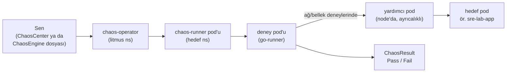

# Litmus kurulumu

Bu doküman chaos senaryoları (T1.8) için LitmusChaos'un kümeye nasıl kurulacağını adım adım anlatır. Komutlar kopyala-yapıştır içindir; her adımın sonunda bir doğrulama var.

> **Durum:** GKE'de **Yol 2** kuruldu ve doğrulandı (2026-10-04): ChaosCenter `http://litmus.example.internal` arkasında, ajanın yetkisi `sre-lab` ve `loadtest` ile sınırlı (bölüm 8.1), `sre-lab`'da pod-delete deneyi Pass. Yol 1 (yalnızca çekirdek) GKE'de denenmedi. Karar: ADR-026.

## Kısaca

İki kurulum yolu var. **Yalnızca birini seç**; ikisi aynı anda kurulursa iki chaos-operator aynı deneyleri yönetmeye çalışır.

| | Yol 1: yalnızca çekirdek | Yol 2: ChaosCenter ile |
| --- | --- | --- |
| Ne kurulur | chaos-operator ve deney tanımları | Web arayüzü (ChaosCenter), MongoDB, küme ajanı (operator dahil), deney tanımları |
| MongoDB | gerekmez | gerekir: **resmi `mongo:8.0` image'ı**, Bitnami yok |
| Deney nasıl başlatılır | Dosyayla (`ChaosEngine`) | Arayüzden ya da dosyayla |
| Ne zaman | Hedef ortamda, otomasyonda (T1.9) | Öğrenmek, deneyleri ekranda görmek |
| Bölümler | 3, 4, 5 | 6, 7, 8, 8.1, sonra 4 ve 5 |

Öğrenmek için **Yol 2**'yi öneriyorum. Senaryo betikleri (T1.9) iki yolda da aynı `ChaosEngine` dosyalarıyla çalışır.

**Bitnami neden sorun?** Bitnami, Ağustos 2025'te ücretsiz image yayınlamayı bıraktı; eski image'lar güncellenmeyen `bitnamilegacy` deposuna taşındı. Litmus'un `litmus` chart'ı MongoDB'yi hâlâ oradan çekiyor (`bitnamilegacy/mongodb`). Biz chart'ın MongoDB'sini kapatıp (`mongodb.enabled=false`) kendi MongoDB'mizi resmi image'la kuruyoruz. Postgres'te yaptığımızın aynısı.

## 1. Litmus'un parçaları

| Parça (Helm chart) | Ne yapar | Yol 1 | Yol 2 |
| --- | --- | --- | --- |
| **litmus-core** | chaos-operator ve üç CRD: `ChaosExperiment`, `ChaosEngine`, `ChaosResult` | ✓ | — (ajan getirir) |
| **kubernetes-chaos** | Hazır deney tanımları (pod-delete, pod-network-latency …) | ✓ seçtiklerimiz | ✓ seçtiklerimiz |
| **litmus** (ChaosCenter) | Web arayüzü, GraphQL sunucusu, kimlik sunucusu | — | ✓ |
| MongoDB | ChaosCenter'ın verisi: kullanıcılar, deney geçmişi | — | ✓ (resmi image) |
| Küme ajanı (chaos infrastructure) | ChaosCenter'ı kümeye bağlar: subscriber, Argo workflow controller, chaos-operator, exporter | — | ✓ (arayüzden indirilir) |

Bir deneyin akışı:



Sürümler (Litmus Helm deposu, Eylül 2026): litmus-core **3.31.1**, kubernetes-chaos **3.31.0**, litmus (ChaosCenter) **3.30.0**.

## 2. Ön koşullar

- `kubectl`, `helm` (4.x), `yq`, `openssl` kurulu; küme bağlamı tanımlı ve oturum açık (`gcloud auth login`).
- Hedef namespace'ler var: `sre-lab` (uygulama senaryoları) ve `loadtest` (Milvus senaryoları). `acme`'ya dokunulmaz.
- Her terminal oturumunda önce bunları çalıştır:

```bash
export CTX=gke_example-project_us-central1-a_example-gke
export CORE_VERSION=3.31.1          # litmus-core chart'ı (Yol 1)
export EXPERIMENTS_VERSION=3.31.0   # kubernetes-chaos chart'ı
export CENTER_VERSION=3.30.0        # litmus (ChaosCenter) chart'ı (Yol 2)
export LITMUS_IMAGE_TAG=3.31.0

helm repo add litmuschaos https://litmuschaos.github.io/litmus-helm/
helm repo update litmuschaos
```

---

## Yol 1: yalnızca çekirdek (MongoDB'siz)

## 3. Operator ve CRD'ler (litmus-core)

Image'lar Litmus'un sayaç proxy'si (`litmuschaos.docker.scarf.sh`) yerine doğrudan Docker Hub'dan çekilir; hedef ortamda bu adresler Nexus aynasına çevrilir. Kullanım istatistiği gönderimi kapatılır.

```bash
helm upgrade --install chaos litmuschaos/litmus-core --version $CORE_VERSION \
  --kube-context $CTX -n litmus --create-namespace \
  --set operator.image.repository=docker.io/litmuschaos/chaos-operator \
  --set operator.image.tag=$LITMUS_IMAGE_TAG \
  --set runner.image.repository=docker.io/litmuschaos/chaos-runner \
  --set runner.image.tag=$LITMUS_IMAGE_TAG \
  --set policies.monitoring.disabled=true \
  --wait
```

**Doğrula:**

```bash
kubectl --context $CTX -n litmus get pods                   # chaos-operator-… Running
kubectl --context $CTX get crd | grep litmuschaos.io        # chaosengines, chaosexperiments, chaosresults
```

Sonra bölüm 4 ve 5.

## 4. Deney tanımları (iki yolda da)

`kubernetes-chaos` chart'ı 29 deneyin yanında **küme çapında geniş yetkili** bir ServiceAccount da kurar: bütün namespace'lerde pod, deployment ve secret yazma, node değiştirme. Onu kurmuyoruz. Chart'tan yalnızca seçtiğimiz deney tanımlarını alıp hedef namespace'lere uyguluyoruz.

Seçilen deneyler: `pod-delete`, `pod-memory-hog`, `pod-cpu-hog`, `pod-network-latency`, `pod-network-loss`.

```bash
for NS in sre-lab loadtest pilot; do
  helm template k8s litmuschaos/kubernetes-chaos --version $EXPERIMENTS_VERSION -n $NS \
    --set image.litmusGO.repository=docker.io/litmuschaos/go-runner \
    --set image.litmusGO.tag=$LITMUS_IMAGE_TAG \
    --set image.litmusLIBImage.repository=docker.io/litmuschaos/go-runner \
    --set image.litmusLIBImage.tag=$LITMUS_IMAGE_TAG \
    --set environment.runtime=containerd \
    --set environment.socketPath=/run/containerd/containerd.sock \
  | yq 'select(.kind == "ChaosExperiment" and (.metadata.name == "pod-delete" or .metadata.name == "pod-memory-hog" or .metadata.name == "pod-cpu-hog" or .metadata.name == "pod-network-latency" or .metadata.name == "pod-network-loss"))' \
  | kubectl --context $CTX -n $NS apply -f -
done
```

**Doğrula:**

```bash
kubectl --context $CTX -n sre-lab get chaosexperiments    # 5 deney
kubectl --context $CTX -n loadtest get chaosexperiments   # 5 deney
```

## 5. Deneylerin kimliği (iki yolda da; yalnızca kendi namespace'inde yetkili)

Her hedef namespace'te `litmus-admin` adlı bir ServiceAccount açılır. Yetkisi yalnızca o namespace'te; secret okuyamaz, node'lara dokunamaz.

```bash
for NS in sre-lab loadtest pilot; do
kubectl --context $CTX -n $NS apply -f - <<'EOF'
apiVersion: v1
kind: ServiceAccount
metadata:
  name: litmus-admin
  labels: {app.kubernetes.io/part-of: sre-agent-chaos}
---
apiVersion: rbac.authorization.k8s.io/v1
kind: Role
metadata:
  name: litmus-admin
  labels: {app.kubernetes.io/part-of: sre-agent-chaos}
rules:
  - apiGroups: [""]
    resources: [pods, pods/exec, pods/log, pods/eviction, events, configmaps, services]
    verbs: [create, delete, get, list, patch, update, deletecollection, watch]
  - apiGroups: [batch]
    resources: [jobs]
    verbs: [create, delete, get, list, deletecollection, watch]
  - apiGroups: [apps]
    resources: [deployments, statefulsets, replicasets, daemonsets]
    verbs: [get, list, patch, update]
  - apiGroups: [litmuschaos.io]
    resources: [chaosengines, chaosexperiments, chaosresults]
    verbs: [create, delete, get, list, patch, update, watch]
---
apiVersion: rbac.authorization.k8s.io/v1
kind: RoleBinding
metadata:
  name: litmus-admin
  labels: {app.kubernetes.io/part-of: sre-agent-chaos}
roleRef: {apiGroup: rbac.authorization.k8s.io, kind: Role, name: litmus-admin}
subjects:
  - {kind: ServiceAccount, name: litmus-admin}
EOF
done
```

**Doğrula** (beklenen sırayla: yes, no, no):

```bash
kubectl --context $CTX auth can-i delete pods -n sre-lab --as=system:serviceaccount:sre-lab:litmus-admin
kubectl --context $CTX auth can-i delete pods -n acme   --as=system:serviceaccount:sre-lab:litmus-admin
kubectl --context $CTX auth can-i get secrets -n sre-lab --as=system:serviceaccount:sre-lab:litmus-admin
```

Sonra ilk deney: bölüm 9.

---

## Yol 2: ChaosCenter ile (MongoDB resmi image'la)

## 6. MongoDB (Bitnami'siz)

ChaosCenter, MongoDB'nin **replica set** olarak çalışmasını şart koşuyor (açılışta `rs.status()` ile denetliyor). Tek kopyalı bir replica set kuruyoruz. Kimlik doğrulama açık bir replica set'te MongoDB üyeler arası bir anahtar dosyası (keyFile) istiyor; onu da üretiyoruz.

**6.1 Namespace ve parolalar** (rastgele üretilir, ekrana basılmaz, repoya girmez):

```bash
kubectl --context $CTX create namespace litmus

MONGO_PW=$(openssl rand -hex 24)
kubectl --context $CTX -n litmus create secret generic litmus-mongo \
  --from-literal=root-password="$MONGO_PW" \
  --from-literal=keyfile="$(openssl rand -base64 756 | tr -d '\n')"

# ChaosCenter'ın okuduğu Secret: MongoDB bağlantısı + arayüz yöneticisi
kubectl --context $CTX -n litmus create secret generic litmus-admin-secret \
  --from-literal=DB_USER=root \
  --from-literal=DB_PASSWORD="$MONGO_PW" \
  --from-literal=ADMIN_USERNAME=admin \
  --from-literal=ADMIN_PASSWORD="$(openssl rand -hex 12)"
unset MONGO_PW
```

**6.2 MongoDB'yi kur** (StatefulSet, 10 GiB disk, resmi `mongo:8.0`):

```bash
kubectl --context $CTX -n litmus apply -f - <<'EOF'
apiVersion: v1
kind: Service
metadata:
  name: litmus-mongo-headless
  labels: {app.kubernetes.io/name: litmus-mongo}
spec:
  clusterIP: None
  selector: {app.kubernetes.io/name: litmus-mongo}
  ports: [{name: mongo, port: 27017}]
---
apiVersion: apps/v1
kind: StatefulSet
metadata:
  name: litmus-mongo
  labels: {app.kubernetes.io/name: litmus-mongo}
spec:
  serviceName: litmus-mongo-headless
  replicas: 1
  selector:
    matchLabels: {app.kubernetes.io/name: litmus-mongo}
  template:
    metadata:
      labels: {app.kubernetes.io/name: litmus-mongo}
    spec:
      securityContext: {runAsUser: 999, runAsGroup: 999, fsGroup: 999, runAsNonRoot: true}
      initContainers:
        # keyFile yalnızca sahibince okunabilir olmalı (400): Secret'tan kopyalanıp izni daraltılır.
        - name: keyfile
          image: docker.io/library/mongo:8.0
          command: [sh, -c, "cp /keyfile-src/keyfile /keyfile/keyfile && chmod 400 /keyfile/keyfile"]
          volumeMounts:
            - {name: keyfile-src, mountPath: /keyfile-src, readOnly: true}
            - {name: keyfile, mountPath: /keyfile}
      containers:
        - name: mongo
          image: docker.io/library/mongo:8.0
          args: [--replSet, rs0, --bind_ip_all, --keyFile, /keyfile/keyfile]
          env:
            - {name: MONGO_INITDB_ROOT_USERNAME, value: root}
            - name: MONGO_INITDB_ROOT_PASSWORD
              valueFrom: {secretKeyRef: {name: litmus-mongo, key: root-password}}
          ports: [{name: mongo, containerPort: 27017}]
          readinessProbe:
            exec: {command: [mongosh, --quiet, --eval, "db.adminCommand('ping')"]}
            initialDelaySeconds: 10
            periodSeconds: 10
          resources:
            requests: {cpu: 100m, memory: 512Mi}
            limits: {memory: 1Gi}
          volumeMounts:
            - {name: data, mountPath: /data/db}
            - {name: keyfile, mountPath: /keyfile}
      volumes:
        - name: keyfile-src
          secret: {secretName: litmus-mongo, items: [{key: keyfile, path: keyfile}]}
        - name: keyfile
          emptyDir: {}
  volumeClaimTemplates:
    - metadata: {name: data}
      spec:
        accessModes: [ReadWriteOnce]
        resources: {requests: {storage: 10Gi}}
EOF

kubectl --context $CTX -n litmus rollout status statefulset/litmus-mongo --timeout=5m
```

**6.3 Replica set'i başlat** (bir kez; parola pod'un içindeki ortam değişkeninden okunur, ekrana basılmaz):

```bash
kubectl --context $CTX -n litmus exec litmus-mongo-0 -- sh -c \
  'mongosh -u root -p "$MONGO_INITDB_ROOT_PASSWORD" --quiet --eval "rs.initiate({_id: \"rs0\", members: [{_id: 0, host: \"litmus-mongo-0.litmus-mongo-headless.litmus.svc.cluster.local:27017\"}]})"'
```

**Doğrula** (beklenen: `1` ve `PRIMARY`):

```bash
kubectl --context $CTX -n litmus exec litmus-mongo-0 -- sh -c \
  'mongosh -u root -p "$MONGO_INITDB_ROOT_PASSWORD" --quiet --eval "rs.status().ok; rs.status().members[0].stateStr"'
```

## 7. ChaosCenter

Chart'ın kendi MongoDB'si kapatılır, bağlantı bizim MongoDB'mize verilir, parolalar 6.1'deki Secret'tan okunur. Image'lar Docker Hub'dan.

```bash
helm upgrade --install chaos-center litmuschaos/litmus --version $CENTER_VERSION \
  --kube-context $CTX -n litmus \
  --set mongodb.enabled=false \
  --set existingSecret=litmus-admin-secret \
  --set adminConfig.DB_SERVER='mongodb://litmus-mongo-0.litmus-mongo-headless.litmus.svc.cluster.local:27017/admin' \
  --set image.imageRegistryName=docker.io/litmuschaos \
  --set ingress.enabled=true \
  --set ingress.ingressClassName=nginx \
  --set ingress.host.name=litmus.example.internal \
  --set-string 'ingress.annotations.nginx\.ingress\.kubernetes\.io/ssl-redirect=false' \
  --set-string 'ingress.annotations.ingress\.kubernetes\.io/ssl-redirect=false' \
  --set-string 'ingress.annotations.nginx\.ingress\.kubernetes\.io/proxy-read-timeout=3600' \
  --wait --timeout 10m
```

Ingress diğerleri gibi (`grafana`, `sre-agent`): `nginx` sınıfı, HTTP. `proxy-read-timeout` arayüzün WebSocket bağlantısı kopmasın diye.

**Doğrula:**

```bash
kubectl --context $CTX -n litmus get pods
# chaos-center-litmus-frontend-…, -server-…, -auth-server-… Running; litmus-mongo-0 Running
kubectl --context $CTX -n litmus get ingress    # litmus-ingress  litmus.example.internal
```

**Arayüzü aç:** `http://litmus.example.internal` (şirket içi DNS, `*.vectordb.example`). Kullanıcı `admin`. Parolayı **kendi terminalinde** (ekran paylaşmadan) oku:

```bash
kubectl --context $CTX -n litmus get secret litmus-admin-secret -o jsonpath='{.data.ADMIN_PASSWORD}' | base64 -d; echo
```

İlk girişte ChaosCenter parolayı değiştirmeni ister.

## 8. ChaosCenter'ı kümeye bağla (chaos infrastructure)

Arayüz deneyleri kümeye bir ajan üzerinden yaptırır. Ajan arayüzden üretilen bir YAML ile kurulur:

1. ChaosCenter'da **Environments → New Environment**: ad `gke`, tür `Non-Production`.
2. Ortamın içinde **Enable Chaos**: ad `gke-litmus`, kurulum yöntemi **Kubernetes**, kapsam **Cluster-wide**, namespace `litmus`, ServiceAccount `litmus`.
3. **Download** ile YAML'ı indir (ör. `~/Downloads/gke-litmus-litmus-chaos-enable.yml`).
4. **Sunucu adresini düzelt.** ChaosCenter adresi release adı `chaos` sanarak yazıyor (`http://chaos-litmus-server-service:9002/query`); bizim release `chaos-center`. Düzeltilmezse `subscriber` pod'u "no such host" ile CrashLoopBackOff'a düşer.

```bash
sed -i '' 's#SERVER_ADDR: http://chaos-litmus-server-service:9002/query#SERVER_ADDR: http://chaos-center-litmus-server-service.litmus.svc.cluster.local:9002/query#' \
  ~/Downloads/gke-litmus-litmus-chaos-enable.yml
grep -n 'SERVER_ADDR' ~/Downloads/gke-litmus-litmus-chaos-enable.yml   # chaos-center-litmus-server-service…
```

5. Uygula:

```bash
kubectl --context $CTX apply -f ~/Downloads/gke-litmus-litmus-chaos-enable.yml
```

**Doğrula:**

```bash
kubectl --context $CTX -n litmus get pods
# + chaos-operator-…, subscriber-…, workflow-controller-…, chaos-exporter-…, event-tracker-… Running
```

Arayüzde altyapının durumu birkaç dakika içinde **CONNECTED** olur.

## 8.1 Ajanın yetkisini namespace'lerle sınırla (zorunlu)

Ajan cluster-wide kurulduğunda üç hesabı (`litmus`, `litmus-admin`, `argo-chaos`) **küme çapında yazma** yetkisiyle gelir: arayüzde yanlış namespace seçilirse gerçek bir tenant'ın pod'ları silinebilir. `litmus-scope` chart'ı aynı yetkileri yalnızca izin listesindeki namespace'lerde verir, ajanın küme çapındaki bağlarını siler, kümede yalnızca okuma bırakır (ADR-026).

İzin listesi: `deploy/values/gke/litmus-scope.yaml` (`sre-lab`, `loadtest`). Korunan namespace'ler (`acme`, `vectordb` …) listeye yazılırsa kurulum durur.

```bash
make litmus-scope     # uygular ve sonunda denetler
make litmus-check     # yalnızca denetler: izinli ns'de pod silme evet, korunanlarda hayır, secret hayır
```

- **Yeni namespace eklemek:** listeye bir satır ekle, `make litmus-scope`.
- **Ajanı arayüzden güncellersen ya da yeniden kurarsan** küme çapındaki bağlar geri gelir; `make litmus-check` bunu FAIL ile gösterir, `make litmus-scope` düzeltir.
- Kısıtlamadan sonra ajanın loglarında yetki hatası kalmamalı:

```bash
for d in chaos-operator-ce subscriber event-tracker chaos-exporter workflow-controller; do
  echo "$d: $(kubectl --context $CTX -n litmus logs deploy/$d --since=5m | grep -ci forbidden)"
done    # hepsi 0
```

Sonra bölüm 4 ve 5 (deney tanımları ve kimlik), ardından bölüm 9.

---

## 9. İlk deney: sre-lab'da pod silme (iki yolda da)

Zararsız bir deneme: `sre-lab-app` pod'u 30 saniye boyunca 10 saniyede bir silinir; Deployment yenisini açar.

```bash
kubectl --context $CTX -n sre-lab apply -f - <<'EOF'
apiVersion: litmuschaos.io/v1alpha1
kind: ChaosEngine
metadata:
  name: deneme-pod-delete
  labels: {app.kubernetes.io/part-of: sre-agent-chaos}
spec:
  engineState: active
  chaosServiceAccount: litmus-admin
  appinfo:
    appns: sre-lab
    applabel: app.kubernetes.io/name=sre-lab-app
    appkind: deployment
  jobCleanUpPolicy: delete
  experiments:
    - name: pod-delete
      spec:
        components:
          env:
            - {name: TOTAL_CHAOS_DURATION, value: "30"}
            - {name: CHAOS_INTERVAL, value: "10"}
            - {name: FORCE, value: "false"}
EOF
```

**İzle ve sonucu oku:**

```bash
kubectl --context $CTX -n sre-lab get pods -w     # runner, deney pod'u, silinip yeniden açılan uygulama (Ctrl+C)
kubectl --context $CTX -n sre-lab get chaosresult deneme-pod-delete-pod-delete \
  -o jsonpath='{.status.experimentStatus.verdict}{"\n"}'   # Pass
```

**Temizle:**

```bash
kubectl --context $CTX -n sre-lab delete chaosengine deneme-pod-delete
kubectl --context $CTX -n sre-lab get deploy sre-lab-app   # 1/1 hazır
```

Yol 2'de aynı deneyi arayüzden de yapabilirsin: **Chaos Experiments → New Experiment**, altyapı `gke-litmus`, hazır şablonlardan **pod-delete**, hedef namespace `sre-lab`, etiket `app.kubernetes.io/name=sre-lab-app`. Arayüz deneyin adımlarını ve sonucunu canlı gösterir.

## 10. Kaldırma

Deneyler ve kimlikler (iki yolda da):

```bash
for NS in sre-lab loadtest pilot; do
  kubectl --context $CTX -n $NS delete chaosengines --all
  kubectl --context $CTX -n $NS delete chaosexperiments,chaosresults --all
  kubectl --context $CTX -n $NS delete serviceaccount,role,rolebinding -l app.kubernetes.io/part-of=sre-agent-chaos
done
```

Yol 1:

```bash
helm uninstall chaos --kube-context $CTX -n litmus
kubectl --context $CTX delete namespace litmus
```

Yol 2:

```bash
kubectl --context $CTX delete -f ~/Downloads/gke-litmus-litmus-chaos-enable.yml   # küme ajanı
helm uninstall chaos-center --kube-context $CTX -n litmus
kubectl --context $CTX delete namespace litmus    # MongoDB, diski ve Secret'lar dahil
```

CRD'ler Helm ya da ajan tarafından silinmez; tamamen kaldırmak için:

```bash
kubectl --context $CTX delete crd chaosengines.litmuschaos.io chaosexperiments.litmuschaos.io chaosresults.litmuschaos.io
```

## 11. Güvenlik notları

- **Operator küme çapında.** chaos-operator'ın ClusterRole'ü bütün namespace'lerde pod ve configmap yazabiliyor, secret okuyabiliyor. Bu Litmus'un tasarımı; iki yolda da böyle. Bizim kısıtımız deneylerin kimliğinde: deneyler yalnızca `sre-lab` ve `loadtest`'te yetkili (bölüm 5). Hedef ortamda operatörün yetkisi ayrıca onay ister.
- **Yol 2'nin ajanı daha geniş.** Cluster-wide kurulan ajan (Argo workflow controller dahil) küme çapında yazma yetkisiyle gelir. GKE'de `litmus-scope` ile listelenen namespace'lere indirildi (bölüm 8.1); hedef ortamda önerilmez.
- **Ağ ve bellek deneyleri ayrıcalıklı.** `pod-network-*`, `pod-memory-hog` ve `pod-cpu-hog`, hedef pod'un node'unda ayrıcalıklı (privileged, hostPID) bir yardımcı pod açar ve containerd soketine erişir. Chaos Mesh de aynısını yapar. GKE'de çalışır; hedef ortamda (OpenShift SCC) ayrıca izin gerekir.
- **ChaosCenter'ın girişi.** GKE'de `http://litmus.example.internal` şirket ağına açık; giriş parolalı, SSO yok, bağlantı HTTP (parola şifresiz gider). Öğrenme ortamı için kabul edildi; kalıcı kullanımda SSO ve TLS konuşulmalı. Yönetici parolası rastgele üretilir ve ilk girişte değiştirilir.
- **sre-agent'ın salt okunur kuralı değişmez.** Litmus ayrı bir bileşen; sre-agent ona yetki vermez, ondan yetki almaz.
- **Node deneyleri kurulmadı.** `node-drain` küme çapında node yetkisi ister ve paylaşılan 3 node'u etkiler; ayrı karar gerektirir (T1.8, senaryo 09).

## 12. Bizim senaryolara karşılığı

Senaryoların kendisi `scenarios/` altında; `make scenarios` listeler, `make scenario-inject S=<ad>` ve `make scenario-cleanup S=<ad>` çalıştırır.

| # | Senaryo | Litmus deneyi | Not |
| --- | --- | --- | --- |
| 01 | CrashLoopBackOff | — | Hatalı başlama komutuyla deploy (Litmus gerekmez) |
| 02 | OOMKilled | — | Bellek limiti 8Mi'ye düşürülür (helm); plandaki tarifle aynı, Litmus gerekmez |
| 03 | ImagePullBackOff | — | Yanlış image etiketi (Litmus gerekmez) |
| 04 | Yanlış ConfigMap | — | `kubectl edit` (Litmus gerekmez) |
| 05 | Pending pod | — | Karşılanamayacak kaynak isteği (Litmus gerekmez) |
| 06 | Milvus querynode kotası | `pod-memory-hog` (querynode) | ~7400 MiB (limitin ~%91'i); MilvusTenant'a dokunmadan, veri yazmadan |
| 07 | Milvus bağlantı tükenmesi | — | Yük üreticisi gerekiyor; `milvus_connections` kontrolü zaten çalışmıyor (katalog) |
| 08 | Ağ gecikmesi | `pod-network-latency` | sre-lab |
| 09 | Node kaybı | (`node-drain`) | Kurulmadı; karar bekliyor |
| 10 | Object storage kesintisi | `pod-network-loss` | `DESTINATION_HOSTS=storage.googleapis.com`, %100 kayıp; loadtest |
| 11 | Kafka lag | — | Consumer'ı durdurmak (`pipeline-demo` gibi) |

Kaynaklar: [Litmus Helm chart'ları](https://github.com/litmuschaos/litmus-helm) · [ChaosCenter kurulumu](https://docs.litmuschaos.io/docs/getting-started/installation) · [Bitnami legacy image'ları ve alternatifleri](https://www.osseva.io/blog/replace-bitnamilegacy-images-helm-charts)
